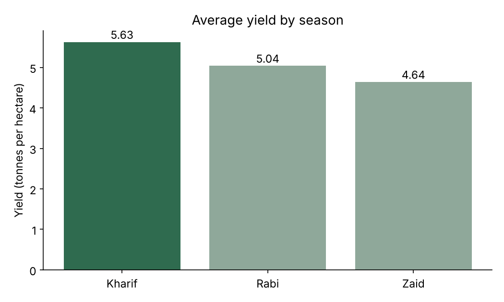
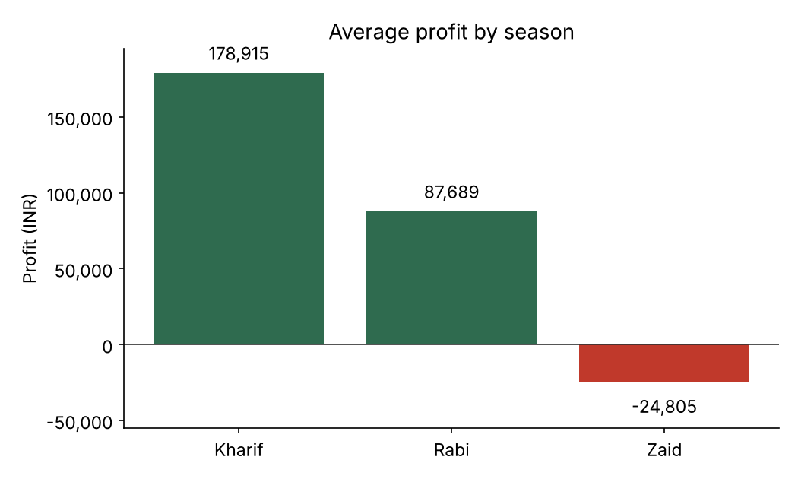
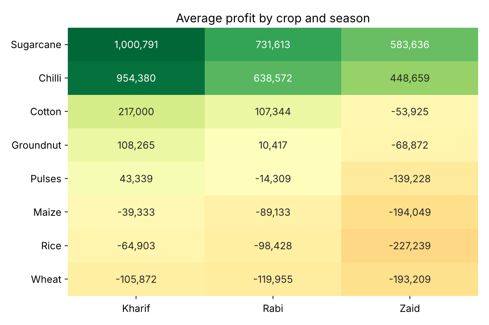
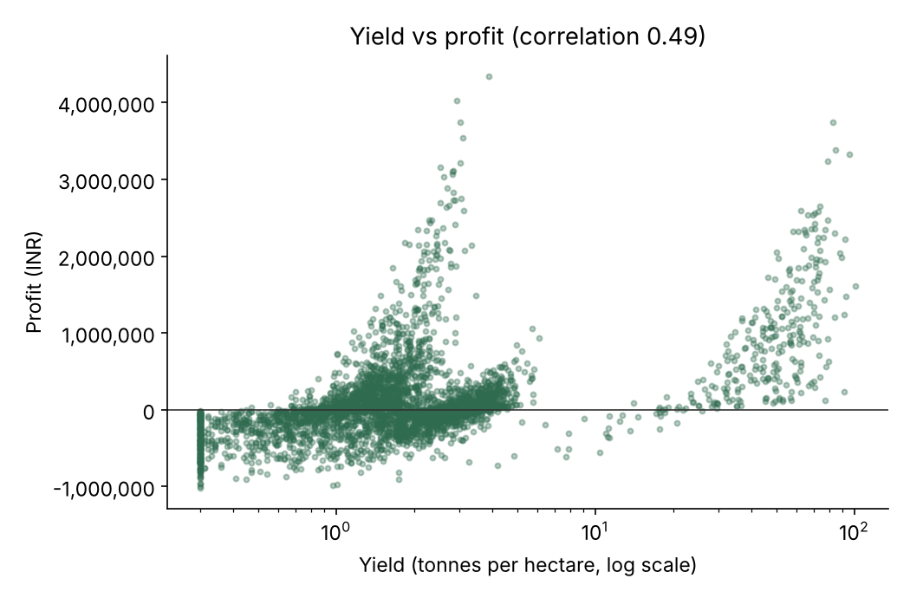

# Seasonal Agriculture Performance Analysis

Python analysis of how crop performance changes across the Kharif, Rabi and Zaid seasons: yield, profit, water efficiency and pest risk.

**Business question:** which season and crop combinations make money, and which lose it?

**Short answer:** Kharif earns the most (178,915 INR average profit) and Zaid loses money on average (-24,805 INR). Cereals sown in Zaid are the weakest combinations, and sugarcane and chilli in Kharif are the strongest.

This is a descriptive analysis. It measures and compares; it does not build a predictive model.

## Objectives

- Compare agricultural performance across seasons
- Analyze yield and profitability
- Compare crop performance across seasons
- Examine water use and water efficiency
- Identify relationships between environmental and resource variables and outcomes
- Identify high- and low-performing crop-season combinations
- Analyze profitability risk

## Data

4,000 farm records and 28 columns, covering 8 states and 8 crops (Kharif 1,779 farms, Rabi 1,627, Zaid 594). Columns cover crop, season, weather, soil, inputs (fertilizer, pesticide, irrigation), yield, cost, revenue, profit, water use and disease/pest risk.

- Source: the dataset provided for this project (original source not documented).
- Missing values: 120 cells in total (Rainfall 48, Soil moisture 40, Yield 32). The notebook fills them with the column median, not zero.
- 220 farms sit at the minimum yield value of 0.3, which looks like a floor in the data.
- District names do not match their states (for example Rajkot appears under Andhra Pradesh), so this looks like a practice dataset. I did not analyse by district. Treat the results as an exercise on sample data, not real farm performance.

## Key findings

| Season | Farms | Avg yield (t/ha) | Avg profit (INR) | Farms at a loss |
|---|---|---|---|---|
| Kharif | 1,779 | 5.63 | 178,915 | 42.2% |
| Rabi | 1,627 | 5.04 | 87,689 | 51.1% |
| Zaid | 594 | 4.64 | -24,805 | 64.5% |

- **Kharif performs best** on yield, profit and water efficiency (5.89 t per 1,000 m3, against 5.19 for Rabi and 4.41 for Zaid).
- **Zaid is the weakest season.** Average profit is negative and almost two in three Zaid farms lose money.
- **The yield gap is not a crop-mix effect.** Sugarcane makes up a similar share in each season (7.0%, 7.9%, 8.6%), and with sugarcane removed Kharif still leads (2.01 t/ha, against 1.75 for Rabi and 1.47 for Zaid).
- **Crop matters as much as season.** Sugarcane (817,188 INR average profit) and Chilli (750,878) lead. Rice, Wheat and Maize average a loss. The weakest combinations are Rice in Zaid (-227,239), Maize in Zaid (-194,049) and Wheat in Zaid (-193,209). The strongest are Sugarcane in Kharif (1,000,791) and Chilli in Kharif (954,380).
- **Yield and profit are moderately related** (correlation 0.49), but sugarcane pulls that figure up. Without sugarcane it is 0.30, so price and cost matter a lot.
- **Kharif carries the most pest risk** (54.5% average, against 40.5% in Rabi and 38.2% in Zaid), so its profit comes with more exposure.

Compare yields within a crop, not across crops. Sugarcane yields about 46.6 t/ha, on a different scale from the other crops.

These are associations in one dataset, not proof of cause.

## Charts

## Where I would look next

- Why cereals lose money in Zaid: compare cost per hectare with market price.
- Whether the Kharif pest risk eats into its profit advantage.
- Multi-year data, to check whether the seasonal pattern holds.

## Tools

Python, Pandas, NumPy, Matplotlib, Seaborn, Jupyter Notebook.

## How to run

1. Install the libraries: `pip install pandas numpy matplotlib seaborn jupyter`
2. Keep the notebook and the CSV in the same folder (`Files/`).
3. Open `Seasonal_Agriculture_Performance_Analysis_.ipynb` and run all cells.

A short presentation of the project is in [`Project.pptx`](Project.pptx).

## Author

Prashant Kashyap | [LinkedIn](https://linkedin.com/in/prashantrix) | [GitHub](https://github.com/prashantrix)
